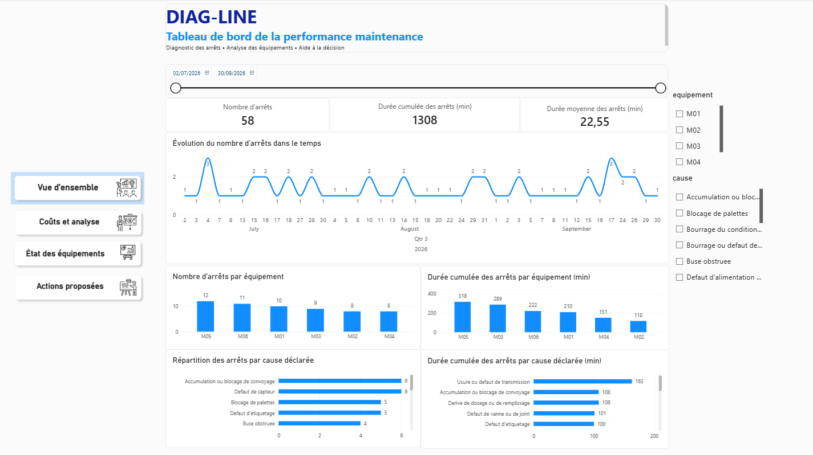
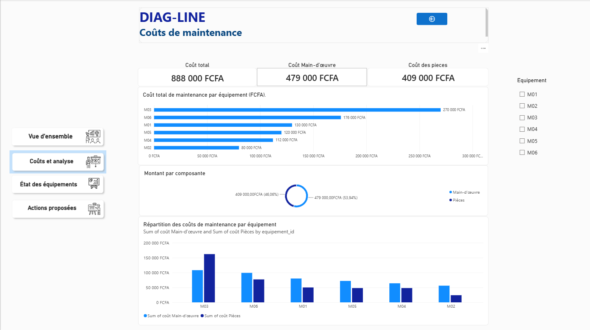
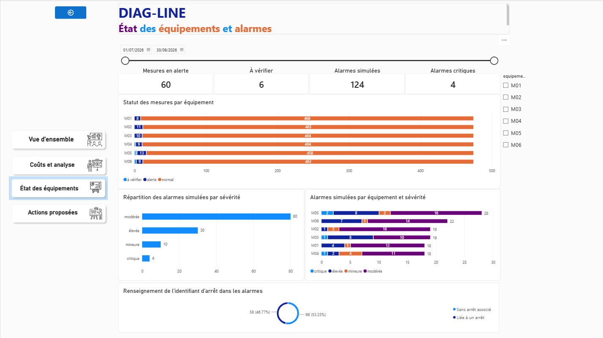
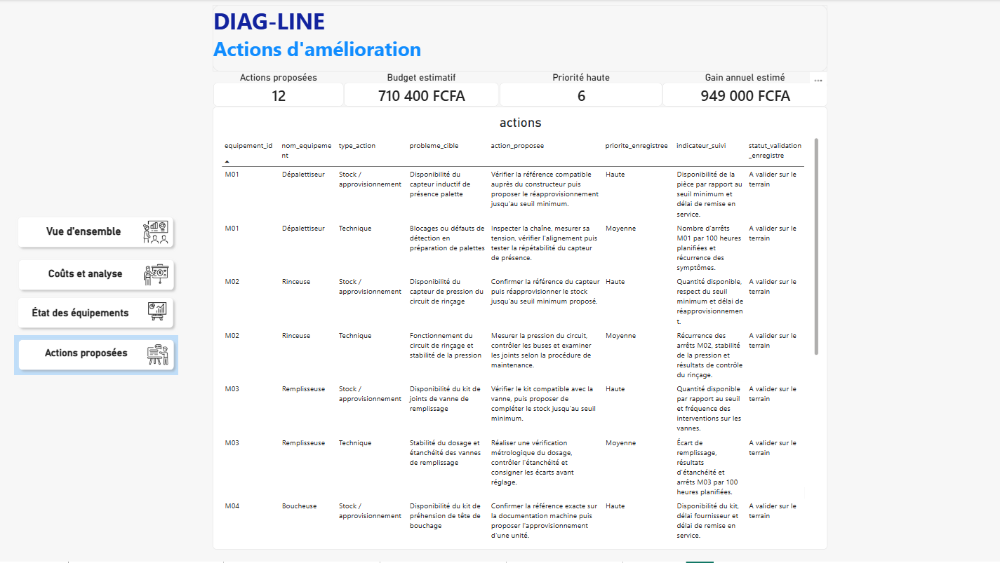

# DIAG-LINE — Diagnostic de maintenance industrielle

## 1. Présentation du projet

DIAG-LINE est un projet de portfolio en ingénierie électromécanique et en analyse de données industrielles, réalisé avec Power BI et Python.

Le projet s'appuie sur un scénario industriel simulé : une **usine fictive d'embouteillage de boissons**, spécialisée dans le conditionnement industriel sur une ligne de production.

L'objectif est de mettre en place une démarche de diagnostic de maintenance permettant d'identifier les équipements les plus problématiques, d'analyser les défaillances et de proposer des actions d'amélioration à partir des données disponibles.

**Contexte industriel :**
- Type d'installation : usine d'embouteillage de boissons.
- Activité : conditionnement industriel.
- Périmètre étudié : équipements et maintenance d'une ligne de conditionnement.
- Nature des données : données entièrement simulées.

## 2. Problématique

Quels équipements et quelles défaillances méritent une attention prioritaire, et quelles actions peut-on proposer à partir des données disponibles ?

## 3. Objectifs

- Analyser les arrêts et leur répartition par équipement.
- Explorer les alarmes et les mesures de condition.
- Examiner les coûts de maintenance.
- Identifier et hiérarchiser les équipements prioritaires.
- Analyser les défaillances et leurs causes potentielles.
- Proposer des actions correctives et préventives.
- Présenter les résultats dans un tableau de bord interactif Power BI.

## 4. Aperçu du tableau de bord

Les captures suivantes illustrent le rapport Power BI développé dans le cadre du projet.

## 5. Outils et technologies

- **Power BI** : modélisation, analyse et visualisation des données.
- **Python** : génération, préparation et audit des données.
- **Pandas** : manipulation et traitement des données.
- **CSV** : stockage des jeux de données.
- **PowerShell** : opérations de préparation et de gestion du projet.

## 6. Choix méthodologiques et indicateurs

Le projet privilégie l'analyse des historiques d'arrêts, des interventions, des alarmes et des mesures de condition.

Les indicateurs TRS, MTBF et MTTR n'ont volontairement pas été intégrés dans cette première version.

Ce choix repose sur le périmètre analytique retenu et sur les exigences de fiabilité des données nécessaires à leur calcul :

- **TRS (Taux de Rendement Synthétique)** : nécessite des données cohérentes de disponibilité, de performance et de qualité de production.
- **MTBF (Mean Time Between Failures)** : nécessite des durées de fonctionnement fiables entre les défaillances.
- **MTTR (Mean Time To Repair)** : nécessite des durées de réparation clairement identifiées, distinctes des éventuels temps d'indisponibilité.

L'objectif est de privilégier un diagnostic cohérent avec les données disponibles plutôt que de multiplier les indicateurs sans disposer de toutes les informations nécessaires à leur interprétation.

## 7. Rapport Power BI

Le fichier `powerbi/final.pbix` contient le rapport interactif du projet.

Il peut être ouvert avec Microsoft Power BI Desktop.

## 8. Données et limites

Toutes les données utilisées sont simulées à des fins de démonstration. Les résultats ne proviennent pas d'une installation industrielle réelle.

Les causes de défaillance constituent des éléments d'analyse et ne doivent pas être considérées comme des causes racines confirmées sur le terrain.

Les coûts, budgets et gains associés aux actions sont estimatifs ou hypothétiques.

Les résultats doivent être confrontés à des observations terrain avant toute décision industrielle réelle.

## 9. Structure du dépôt

- `data/` : jeux de données du projet.
- `docs/` : documentation, hypothèses et règles de cohérence.
- `images/` : captures du rapport Power BI.
- `powerbi/` : rapport Power BI.
- `python/` : scripts de génération, préparation et audit des données.

## 10. Reproduction

Les scripts peuvent dépendre de chemins locaux, de fichiers intermédiaires ou d'une base SQLite.

Leur ordre d'exécution et leurs prérequis doivent être vérifiés avant de tenter une reproduction complète depuis un autre ordinateur.

## Auteur

Projet de portfolio — Ingénierie électromécanique, maintenance industrielle et analyse de données.
